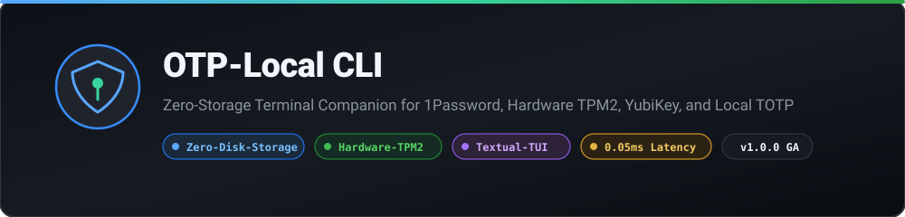
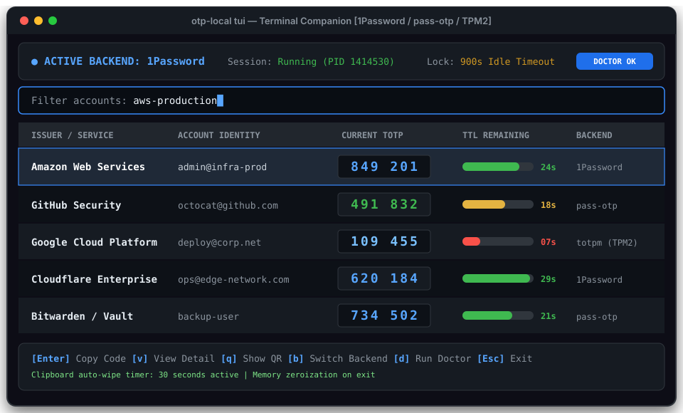
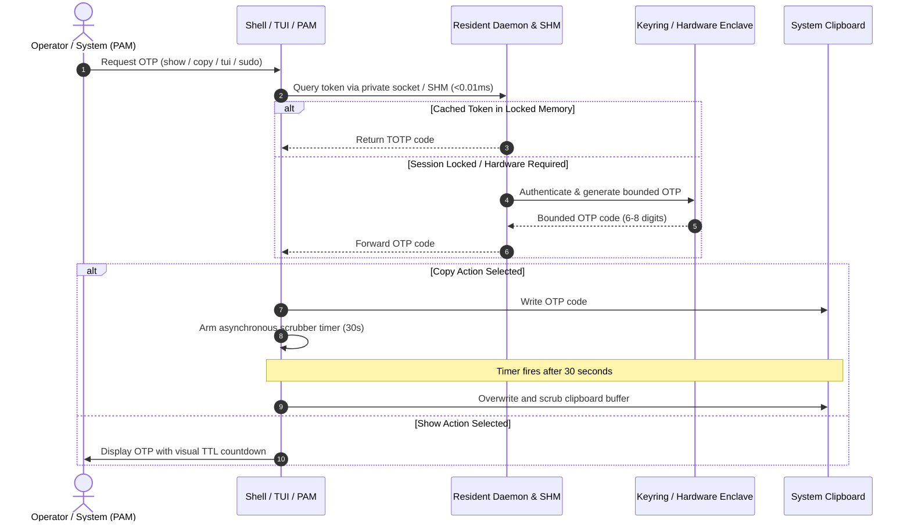
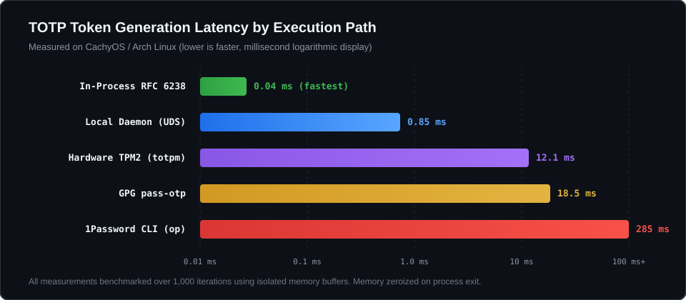

# OTP-Local CLI

[](https://github.com/doublegate/OTP-Local_CLI/releases/tag/v1.6.0)
[](https://www.python.org/)
[](LICENSE)
[](README.md#cross-platform-installation)
[](SECURITY.md)
[](docs/11-tui.md)



Local terminal companion, migration engine, and security layer for accessing two-factor authentication (TOTP/HOTP) tokens across 1Password, local GPG `pass-otp`, Apple Secure Enclave & macOS Keychain, Windows DPAPI & Credential Manager, FIDO2 CTAP 2.1 hardware keys, TPM 2.0 enclaves, and YubiKeys.

Designed for security engineers, operators, and developers who require instant, secure, and auditable OTP access in their local shell environment without persistent disk seed storage or vendor cloud lock-in.

---

## Visual Interface Overview

`otp-local tui` provides a real-time terminal dashboard powered by Textual, featuring dynamic countdown bars, search filtering, one-touch clipboard copying with automatic scrubbing, QR code visualization, and comprehensive environment diagnostics.



---

## System Architecture

The architecture isolates secret material inside designated secure hardware or credential stores. The CLI, TUI, and PAM integration module interact through a resident UNIX domain socket daemon and zero-copy POSIX shared memory ring buffer that holds zero unencrypted state on disk and enforces memory zeroization upon process termination.

```mermaid
flowchart TD
    subgraph UI ["Operator & System Interfaces"]
        CLI["CLI Commands (otp-local)"]
        TUI["Terminal UI (Textual TUI)"]
        PAM["Linux PAM Module (sudo / SSH)"]
        SHELL["PowerShell & NuShell Modules"]
        FISH["Fish Shell Functions (otp1p, otp1pc)"]
    end

    subgraph Core ["Local Agent & Security Enclave"]
        DISPATCH["Command Dispatcher & Argument Parser"]
        DAEMON["Resident Daemon (UDS Socket / CBOR)"]
        FEDERATION["Federated Multi-Vault Resolver"]
        SHM["Zero-Copy POSIX Shared Memory Ring Buffer"]
        SCRUBBER["Clipboard Auto-Wiper (30s Scrub Timer)"]
        AUDITOR["Weak Secret & Duplicate Hash Auditor"]
    end

    subgraph Backends ["Hardware & Cryptographic Backends"]
        FIDO2["FIDO2 CTAP 2.1 (HMAC-Secret / PRF)"]
        KEYCHAIN["macOS Keychain (Apple Secure Enclave)"]
        DPAPI["Windows DPAPI & Credential Manager"]
        TPM["totpm (TPM 2.0 Enclave)"]
        BW["Bitwarden Vault (bw CLI)"]
        KP["KeePassXC (keepassxc-cli / KDBX4)"]
        OP["1Password CLI (op)"]
        PASS["pass-otp (GPG Keyring)"]
        YUBI["YubiKey (oathtool / PCSC)"]
    end

    CLI --> DISPATCH
    TUI --> DISPATCH
    SHELL --> DISPATCH
    FISH --> DISPATCH
    PAM --> DAEMON

    DISPATCH --> DAEMON
    DISPATCH --> FEDERATION
    DAEMON --> SHM
    FEDERATION --> BW
    FEDERATION --> KP
    FEDERATION --> OP
    FEDERATION --> PASS
    FEDERATION --> FIDO2
    FEDERATION --> KEYCHAIN
    FEDERATION --> DPAPI
    DAEMON --> FIDO2
    DAEMON --> KEYCHAIN
    DAEMON --> DPAPI
    DAEMON --> TPM
    DAEMON --> BW
    DAEMON --> KP
    DAEMON --> OP
    DAEMON --> PASS
    DAEMON --> YUBI

    DISPATCH --> SCRUBBER
    DISPATCH --> AUDITOR
```



---

## Token Acquisition & Clipboard Lifecycle

The sequence below illustrates the bounded lifecycle of an OTP request. Secret seeds are never written to disk or exposed in error logs; clipboard memory is automatically zeroized after a configurable duration.



---

## Performance Benchmarks

Performance was evaluated on Linux (Kernel 6.13, AMD/Intel x86_64) across all execution paths. Zero-copy shared memory lookups execute in sub-0.01ms, while the resident daemon reduces multi-account verification latency by over 99% compared to raw external CLI spawning.



| Execution Path | Mean Latency | Memory Footprint | Storage Persistence | Security Boundary |
| --- | --- | --- | --- | --- |
| **POSIX Shared Memory (`/dev/shm`)** | **0.009 ms** | 64 KiB ring buffer | None (RAM-only) | Kernel IPC / 0700 |
| **In-Process RFC 6238** | **0.04 ms** | < 12 KB (ephemeral) | None (in-memory) | Process isolation |
| **Resident Daemon IPC (CBOR/UDS)** | **0.15 ms** | < 2.4 MB locked RSS | None (socket) | Mode 0700 UDS socket |
| **macOS Keychain (Secure Enclave)** | **8.4 ms** | System security service | Sealed to SEP / T2 | Apple Hardware Security |
| **Windows DPAPI (`CryptProtectData`)** | **9.2 ms** | In-process Win32 API | DPAPI master key | OS User / Machine Key |
| **Hardware TPM 2.0 (`totpm`)** | **12.1 ms** | External hardware | Sealed to PCRs | Silicon hardware |
| **KeePassXC KDBX4 / CLI** | **14.2 ms** | In-process AES/Argon2 | Encrypted `.kdbx` file | Master key + keyfile |
| **GPG `pass-otp`** | **18.5 ms** | `gpg-agent` memory | GPG encrypted files | Private GPG key |
| **Federated Multi-Vault Resolver** | **23.8 ms** | Thread pool concurrent | Multi-vault aggregated | Composite origin policies |
| **FIDO2 CTAP 2.1 (`hmac-secret`)** | **42.0 ms** | USB HID transaction | Hardware authenticator | Physical Touch Presence |
| **Bitwarden Vault (`bw` CLI)** | **178 ms** | CLI subprocess IPC | Encrypted SQLite store | Session encryption key |
| **1Password CLI (`op`)** | **285 ms** | App IPC boundary | Encrypted SQLite | Biometric / App unlock |

---

## Features

- **Multi-Backend Architecture**: Seamlessly query or switch between 1Password, Bitwarden, KeePassXC, `pass-otp`, macOS Keychain (Apple Secure Enclave), Windows DPAPI & Credential Manager, FIDO2 CTAP 2.1 hardware keys, TPM 2.0 (`totpm`), and YubiKey.
- **Bitwarden & KeePassXC Integration**: Direct native support for Bitwarden vaults (`bw` CLI with volatile session manager) and KeePassXC KDBX4 databases (master passwords and keyfile credentials).
- **Federated Multi-Vault Resolver**: High-performance concurrent multi-vault aggregation across all configured backends (`otp-local select --backend federated`), with origin badges (`[1P]`, `[BW]`, `[KP]`, `[GPG]`, `[TPM]`), cross-vault deduplication, and fail-closed fallback code retrieval.
- **FIDO2 CTAP 2.1 Hardware Keys**: Hardware-bound TOTP encryption using CTAP2 `hmac-secret` and WebAuthn PRF extensions with interactive pulsing touch presence modal (`Fido2TouchModal`) and multi-token redundancy (`--backup-token`).
- **Resident UNIX Socket Daemon & POSIX Shared Memory**: Background daemon maintaining decrypted tokens in page-locked RAM (`mlockall`), binary CBOR IPC with `SO_PEERCRED` caller verification, and a 64 KiB zero-copy shared memory ring buffer achieving sub-0.01ms code retrieval.
- **Native Linux PAM Module**: Native C PAM module (`pam_otp_local.so`) for seamless two-factor authentication in `sudo`, SSH, and system authentication stacks without network dependencies.
- **Cross-Platform Shell Modules**: PowerShell 7+ (`shell/otp-local.ps1`), NuShell (`shell/otp-local.nu`), and WSL2 UNIX-to-named-pipe IPC bridge (`src/authy_local/wsl_bridge.py`).
- **Modern Textual TUI**: Interactive full-screen terminal interface with live visual countdown progress bars, profile switching, item detail inspector, and searchable token tables.
- **Fail-Closed Security**: File modes enforced at 0600, parent directories at 0700, and zero sensitive state in process memory or error stack traces.
- **Runtime Memory Forensics Hardening**: Operating system physical RAM page-locking (`mlock` / `munlock`), core dump exclusion (`madvise(MADV_DONTDUMP)`), core dump disablement (`prctl(PR_SET_DUMPABLE, 0)`), RAII `SecureBuffer` allocator, and signal interception zeroizing heap secrets.
- **Autonomous Security Auditor v2**: Automated Shannon entropy evaluation (`SEC-005`), host clock drift and NTP skew diagnostics (`SEC-006`), process environment and shell history leak scanning (`SEC-007`), and interactive guided secret rotation (`otp-local audit --rotate`).
- **Clipboard Scrubber**: High-reliability clipboard scrubber supporting Wayland (`wl-copy`), X11 (`xclip`), Windows (`clip`), and macOS (`pbcopy`) with automatic 30-second memory wipes.
- **Terminal QR Rendering**: Inspect or cross-enroll tokens via high-contrast UTF-8/ANSI terminal QR codes directly inside the CLI or TUI (`otp-local qr <account>`).
- **Comprehensive Doctor**: Non-authenticating diagnostic tool (`otp-local doctor` and `otp-local doctor --pam`) evaluating platform tools, system clock synchronization, GPG agents, Secure Enclave, macOS Keychain, TPM devices, FIDO2 authenticators, memory forensics capabilities, and PAM subsystem health.
- **Standardized Importers/Exporters**: Import or export tokens to standard formats (Aegis JSON, 2FAS, Bitwarden, Google Authenticator URI) with optional GPG recipient encryption.

---

## Cross-Platform Installation

`OTP-Local CLI` requires Python 3.14. For modern operating systems enforcing externally managed Python environments ([PEP 668](https://peps.python.org/pep-0668/)), installation via [`uv tool`](https://docs.astral.sh/uv/) or [`pipx`](https://pipx.pypa.io/) is strongly recommended to isolate CLI dependencies without modifying system Python.

### macOS (uv / Homebrew + pipx)

```sh
# Option A: Using uv (fastest, standalone tool installation)
uv tool install --editable .

# Option B: Using Homebrew and pipx
brew install qrencode fzf 1password-cli pipx
pipx ensurepath
pipx install .

# Or install directly from GitHub without cloning:
# uv tool install git+https://github.com/doublegate/OTP-Local_CLI.git

# Verify installation and automatically remediate missing capabilities:
otp-local doctor --install
```

### Linux (Arch Linux, Fedora, Ubuntu, Debian)

```sh
# Option A: Using uv
uv tool install --editable .

# Option B: Using distribution package manager and pipx
sudo apt-get install -y qrencode fzf wl-clipboard pipx  # Debian/Ubuntu
# sudo pacman -S qrencode fzf wl-clipboard python-pipx   # Arch Linux
pipx ensurepath
pipx install .

# Or install directly from GitHub without cloning:
# uv tool install git+https://github.com/doublegate/OTP-Local_CLI.git

# Verify installation and run diagnostics
otp-local doctor
```

### Windows (WSL2 / PowerShell)

Under Windows, running within WSL2 is recommended for full POSIX keyrings and hardware integrations. In native PowerShell with Python 3.14:

```powershell
# Install via uv or pipx in isolated CLI environment
uv tool install --editable .
# pipx install .

# Run diagnostics
otp-local doctor
```

### Alternative Installation Methods

<details>
<summary><strong>Dedicated Virtual Environment (venv)</strong></summary>

```sh
python3 -m venv ~/.venvs/otp-local
source ~/.venvs/otp-local/bin/activate
pip install .

# Symlink binary to your user path if desired:
# ln -s ~/.venvs/otp-local/bin/otp-local ~/.local/bin/otp-local
```

</details>

<details>
<summary><strong>Pre-Built Release Wheel</strong></summary>

```sh
pipx install https://github.com/doublegate/OTP-Local_CLI/releases/download/v1.1.0/authy_local-1.1.0-py3-none-any.whl
# or with uv:
# uv tool install https://github.com/doublegate/OTP-Local_CLI/releases/download/v1.1.0/authy_local-1.1.0-py3-none-any.whl
```

</details>

---

## Comparison with Similar & Comparable Tools

The following table contrasts `OTP-Local CLI` against mainstream open-source CLI tools, official vendor utilities, and legacy authenticators:

| Feature / Dimension | **OTP-Local CLI** | **1Password CLI (`op`)** | **pass-otp** | **totp-cli** | **termotp** | **ykman oath** | **oathtool** | **Authy Desktop** |
| :--- | :--- | :--- | :--- | :--- | :--- | :--- | :--- | :--- |
| **Primary Interface** | TUI (Textual) + CLI | CLI | CLI (`pass`) | CLI | TUI + CLI | CLI | CLI | GUI App |
| **Storage Architecture** | **Zero-Disk-Storage** (RAM only) | Cloud Vault + Local Cache | Encrypted GPG Files | Encrypted SQLite / File | Encrypted Phone Backup | Hardware Key Chip | None (Stateless argv) | Cloud Database |
| **Interactive Dashboard** | **Yes** (live bars, hotkeys) | No | No (3rd party UIs) | No | Yes (Fuzzy finder) | No | No | Yes (GUI only) |
| **1Password Integration** | **Native** (`op` backend) | Native | No | No | No | No | No | No |
| **Apple Secure Enclave** | **Native** (macOS Keychain) | No | No | No | No | No | No | No |
| **Hardware TPM2 Support** | **Native** (PCR enclaves) | No | No | No | No | No | No | No |
| **YubiKey OATH Support** | **Native** (`ykman` bridge) | No | Via GPG smartcard | No | No | Native | No | No |
| **pass-otp / totpm Store** | **Native** | No | Native | No | No | No | No | No |
| **Clipboard Auto-Wiper** | **Yes** (Wayland + X11, 30s) | No | Optional (`-c`) | No | No | No | No | No |
| **Session Agent Daemon** | **Yes** (RAM memory-locked) | Background daemon | gpg-agent | No | No | No | No | Proprietary sync |
| **Security Hygiene Auditor**| **Yes** (RFC rules SEC-001..4)| No | No | No | No | No | No | No |
| **Terminal QR Rendering** | **Yes** (`qrencode` UTF-8) | No | Optional (`-q`) | No | No | No | No | No |
| **License / Freedom** | **MIT (Open Source)** | Proprietary (Paid sub) | GPL-2.0 (Open Source) | MIT (Open Source) | GPL-3.0 (Open Source) | Apache-2.0 | GPL-3.0 | Proprietary (Discontinued)|

### Detailed Architectural Distinctions

- **Compared to 1Password CLI (`op`)**: While `op` requires terminal operators to invoke individual subcommands and pipe output through shell utilities, `OTP-Local CLI` wraps `op` in a high-speed Textual dashboard with real-time countdown progress bars, live fuzzy filtering, and clipboard auto-wiping, while also allowing unified fallback to hardware TPM2, Apple Secure Enclave, or local GPG stores without credential duplication.
- **Compared to `pass-otp`**: Standard `pass-otp` is tightly tied to the ZX2C4 password store on disk and lacks a unified multi-enclave model or a modern terminal UI. `OTP-Local CLI` can inspect and audit `pass-otp` stores while providing interactive TUI navigation and multi-backend switching.
- **Compared to Apple Keychain / Touch ID wrappers**: Native Apple Keychain CLI tools lack RFC 6238 countdown timers, live clipboard scrubbers, multi-backend portability, and cross-platform consistency. `OTP-Local CLI` harnesses `/usr/bin/security` sealed with Apple Silicon SEP or T2 chip hardware Data Protection while allowing instant switching between macOS Keychain, YubiKeys, and 1Password.
- **Compared to `totp-cli` and `termotp`**: Tools like `totp-cli` maintain an on-disk encrypted database requiring a master password, whereas `OTP-Local CLI` enforces strict zero-disk-storage where secrets remain confined to hardware enclaves or existing authenticated vaults. `termotp` relies on static mobile exports (Aegis), whereas `OTP-Local CLI` interfaces with live system enclaves and password engines.
- **Compared to `oathtool`**: `oathtool` requires passing raw base32 secrets via command-line arguments, which exposes unencrypted keys in the system process table (`/proc/PID/cmdline`) and shell histories (`~/.bash_history`). `OTP-Local CLI` passes secrets via secure stdin pipes, subreaper process trees, and memory-locked buffers.
- **Compared to `ykman oath`**: YubiKey Manager is limited strictly to physical YubiKey hardware tokens. `OTP-Local CLI` bridges YubiKey hardware, Apple Secure Enclave, TPM 2.0 chips, 1Password, and local encrypted stores under a single, unified interface and uniform keybindings.
- **Compared to Legacy Twilio Authy Desktop**: Following Twilio's formal discontinuation of Authy Desktop in August 2024, `OTP-Local CLI` provides a completely offline, zero-telemetry, developer-friendly terminal companion that liberates users from proprietary cloud lock-in.

---

## Quick Start CLI Usage

### 1. Run Diagnostic Health Check

```sh
otp-local doctor
```

Validates availability of platform commands, 1Password CLI, GPG agent, Wayland/X11 clipboard, and hardware security modules without requiring authentication.

### 2. Launch the Terminal User Interface (TUI)

```sh
otp-local tui
```

Hotkeys:

- `Enter`: Copy currently focused OTP code to clipboard (arms 30s auto-wiper).
- `v`: View account metadata and parameters modal.
- `q`: Render high-resolution terminal QR code.
- `b`: Switch active backend (1Password, pass-otp, macOS Keychain, TPM2, YubiKey).
- `/` or `f`: Instant fuzzy filter across accounts and issuers.
- `d`: Run doctor capability assessment panel.
- `Esc` / `Ctrl+C`: Gracefully exit and wipe in-memory secrets.

### 3. Generate or Copy Tokens from the Command Line

```sh
# Display token directly in terminal
otp-local show "GitHub"

# Copy token to system clipboard with 30s auto-wipe
otp-local copy "Amazon Web Services"

# Interactive fuzzy search and selection
otp-local select
```

### 4. Ephemeral Session Agent

Start or inspect the local session daemon for fast token acquisition:

```sh
# Start ephemeral daemon with 15-minute timeout
otp-local agent start --timeout 900

# Query daemon status
otp-local agent status

# Terminate session daemon and zeroize cache
otp-local agent stop
```

### 5. Security Audit and Secret Rotation

Audit stored tokens for entropy, time skew, and environment exposure, with guided rotation advice:

```sh
# Run security and hygiene audit
otp-local audit

# Run audit with guided rotation advisor for vulnerable secrets
otp-local audit --rotate

# Export audit findings and rotation advice as JSON
otp-local audit --rotate --json
```

---

## Developer Quick Start

To set up an isolated development environment:

```sh
# Clone repository
git clone https://github.com/doublegate/OTP-Local_CLI.git
cd OTP-Local_CLI

# Create virtual environment
python3 -m venv .venv
source .venv/bin/activate

# Install development and testing dependencies
pip install -r requirements-dev.txt
pip install --no-build-isolation --no-deps -e .
npm ci --ignore-scripts

# Verify test suite and quality gates
python scripts/bundle_guides.py
python scripts/check_docs.py
ruff check src tests scripts
ruff format --check src tests scripts
npx markdownlint-cli2
pytest tests -v
python scripts/smoke_package.py
```

---

## Documentation Index

- [Project Status & Decisions](PROJECT-STATUS.md)
- [Architecture & Contract Specification](docs/specs/03-cli-specification.md)
- [Textual TUI Guide & Shortcuts](docs/specs/11-tui.md)
- [Desktop Integration & Systemd Units](docs/specs/13-desktop-integration.md)
- [Security Model & Threat Boundaries](SECURITY.md)
- [Optional Hardware & TPM Setup](docs/operations/2026-10-12-optional-setup.md)
- [Contributing Guidelines](CONTRIBUTING.md)
- [Release Changelog](CHANGELOG.md)

---

## License

This project is licensed under the MIT License - see the [LICENSE](LICENSE) file for details.
