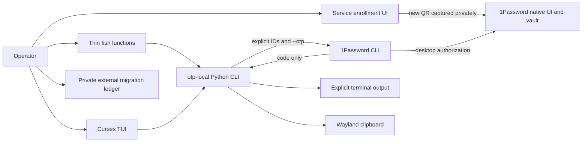

# System architecture

Implementation includes the scoped core, selector, clipboard and reversible installer.
The curses TUI shares the CLI dispatch boundary; see [TUI](11-tui.md),
[ADRs](adr/0002-implementation-boundary.md) and [project status](../PROJECT-STATUS.md).



The enrollment arrow is a human workflow, not a project-owned network transfer.
The 1Password companion never receives the QR or seed. Explicit local-backend
enrollment accepts a seed/URI through repeated hidden terminal input, passes it
to the selected native tool through stdin and releases Python references. It
does not export from another store or promise memory zeroization. A code is
still sensitive even though short lived. The operator ledger is outside this
project and outside agent context.

## Ownership and interfaces

| Component | Owns | Must not own |
|---|---|---|
| cli.py | Argument parsing and exit mapping | Secret persistence or backend internals |
| models.py | Validated scope and bounded code parsing | Raw vendor response objects |
| errors.py | Static error messages and exit codes | Caller values or vendor diagnostics |
| processes.py | Child launch, streaming caps, deadlines, cancellation | Shell command interpolation |
| backends/onepassword.py | Fixed allowed op operations | Enrollment, edit, delete, raw fields |
| backends/local.py | Explicit private pass/totpm scopes, native metadata, generation, hidden-input enrollment and exact local deletion | Automatic fallback, export or seed synchronization |
| interaction.py | Ephemeral scoped metadata, fzf selection and validated clipboard handoff | Full item records, preview commands, history or timers |
| doctor.py | Local capability report | Authentication or item enumeration |
| installer.py | Project file manifest and rollback | System package management or vault/store removal |
| optional_setup.py | Reviewed native-byte installation and private ownership manifest | Key creation, TPM initialization, package installation or store deletion |
| tui.py | Resident-scope navigation, ephemeral browsing/display and confirmed local deletion | Seed/code persistence or automated account changes |
| tui_profiles.py | Private validated account/vault and local-path defaults | Item inventories, seeds or codes |
| deletion_audit.py | Durable coarse local-deletion intent | Entry identities, paths, seeds or codes |
| fish functions | Friendly names and argument forwarding | Retrieval, parsing or error classification |

Dependencies flow from CLI to services to processes/models. Backend code never
calls the CLI. Local adapters share the result/error types and are explicitly
selected. Their operational adoption remains gated by private recovery checks.

## Source layout and planned additions

```text
pyproject.toml
src/authy_local/{__init__,__main__,cli,models,processes,doctor,errors}.py
src/authy_local/backends/{__init__,onepassword,local}.py
src/authy_local/guides/*.md  generated public specs bundled in the wheel
tests/test_*.py              synthetic unit/subprocess integration tests
scripts/check.sh
docs/                       specifications and operator procedures
to-dos/                     plans, with status in PROJECT-STATUS.md
```

The shared `backends/local.py` implements both selected local stores. Missing or
incompatible native tools fail closed; no request falls back to another backend.
No runtime files, private stores or installed environments belong in the repo.

Phase 2 adds `interaction.py`, `installer.py`, `tui.py` and
`fish/{otp1p,otp1pc,otp1pf}.fish`. The installed package contains the installer
and wrapper definitions, so operation does not depend on retaining the checkout.
The current `show` path performs a bounded CLI version probe before its single
scoped retrieval. Both subprocesses receive sanitized environments.

## Runtime flows

Show: parse and validate scope, enforce interactive policy, retrieve once, check
exit and output contract, write the validated code, release references and exit.
No code is printed before the whole response has passed validation.

Local operations validate owned private paths and opaque labels, check native
tool compatibility, then invoke fixed argument lists. Enrollment checks backend
readiness before hidden input and refuses existing targets. Local selection
lists bounded metadata and retrieves only the selected key. See
[the backend contract](08-optional-backends.md).

Copy: verify Wayland/tool capability, retrieve and validate once, write via stdin,
report a generic result with no code. A failed lookup cannot overwrite clipboard.

Select: list Login metadata in the explicit account/vault, enforce limits/schema,
render safe labels, select an index mapped to an immutable ID, retrieve only that
item. A Login without an OTP returns a safe error; do not fetch every full item to
pre-filter. Cancellation ends the invocation with no retrieval or clipboard write.

## Identity and persistence

The tuple `(account_id, vault_id, item_id)` is the retrieval identity. Titles are
display labels, never identifiers. Moving an item to a different vault requires
renewing its mapping; stable IDs are not guaranteed across moves. This follows
the [vendor identifier guidance](https://www.1password.dev/cli/reference).

No default account is inferred from an unlocked app. No aliases or IDs are stored
in the repository. An optional future private alias file would require a separate
schema and permission review. TUI profiles store only account/vault IDs and local
paths in an owned private file; CLI calls still require explicit arguments.
[ADR 0007](adr/0007-confirmed-local-item-deletion.md) records the extended boundary.

## Failure domains

The wrapper can reduce accidental exposure and wrong-item selection; it cannot
isolate secrets from malware running as the user, a compromised desktop session,
or root. Vendor app availability, account authorization, clock quality and service
enrollment are independent dependencies. A green doctor report asserts none of
those account-level guarantees.
