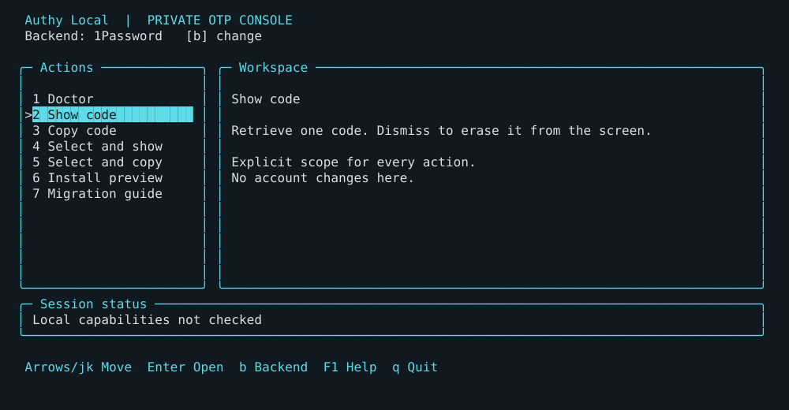

# Local terminal user interface

Run `otp-local tui` in a private, real terminal. The interface is built on the
Textual framework for Python 3.14 on Linux, providing a responsive, async reactive
terminal console with live countdowns and zero network activity.

## Dashboard and design

The dashboard keeps its action sidebar, backend header, detail workspace and
keyboard footer visible together. Normal-height terminals also show a bordered
session-status panel; compact terminals use a status line. Cyan borders and a
filled selection highlight separate navigation from details. Monochrome terminals
use reverse-video selection, and non-UTF terminals use ASCII borders. The status
starts with capabilities not checked: opening the UI proves neither authentication
nor migration readiness. After action 7 completes, Session Status retains the
latest Doctor capability summary for the rest of this TUI session, including
missing or unknown states. It changes only when Doctor is run again; there is no
automatic refresh. Authentication remains unknown, and the summary is not proof
of backend access or migration readiness.

The visual research references are [btop's official project](https://github.com/aristocratos/btop)
and [htop's official site](https://htop.dev/): bordered information panels,
highlighted keyboard selection and visible controls inform this dashboard.
The preview contains synthetic UI state only, with no account or vault data.

## Navigation and capabilities

| Key | Action |
| --- | --- |
| Up/Down or j/k | Move the highlighted action |
| Enter | Open the highlighted action |
| 1 | Browse scoped items and display a selected code |
| 2 | Browse scoped items and copy a selected code |
| 3 | Explicitly scoped code display |
| 4 | Explicitly scoped clipboard copy |
| 5 or a/e | Interactive OTP enrollment modal (secret, URI, QR code) |
| 6 or p | Configure and save the selected backend's resident scope |
| 7 | Non-authenticating doctor capability summary |
| 8 | Preview installation of a supplied local wheel |
| 9 | Private migration checkpoint guide |
| b | Choose backend (1Password, pass-otp, totpm, yubikey, tpm2-totp) |
| v | Display UTF-8 terminal QR code modal for mobile scanning |
| u | Open interactive Credential Security Audit report modal |
| f | Filter by folder / account namespace hierarchy |
| d or Del | Confirmed deletion of single selected local GPG/TPM credential |
| F1 or ? | Keyboard help |
| q or Escape | Quit from the dashboard |

Choosing a backend changes the scope form for subsequent actions; it does not
contact that backend or fall back to another store. 1Password is the initial
backend. Opening action 1 or 2 explicitly lists scoped metadata in the native
Textual browser. The dashboard does not load an inventory automatically or in the
background. Search supports structured prefixes (`type:`, `tag:`, `algo:`, `digits:`).

## Resident scope and item browser

Use **6** or **p** once per selected backend to configure its scope. For 1Password,
enter the CLI account ID, vault ID and optional metadata tag. The tag defaults to
`OTP`, including for existing saved profiles that contain only account/vault IDs.
Use Ctrl-U to clear the tag field and submit it blank to browse all scoped Login
metadata. The account field is the value sometimes
called "User ID" in conversation: it is a 26-character account ID, not an email
address or account password. For pass-otp, configure the store and GPG key-home
paths; for totpm, configure its local configuration path. The optional runtime's
usual paths are form suggestions only; saving requires completing the form.

Saved profiles live at `~/.config/authy-local/tui-profiles.json`, owned by the
operator with mode 0600 in a mode-0700 directory. They contain only backend scope
IDs, paths and the optional 1Password tag filter. Seeds, codes, item titles, item
IDs and service inventories are
never saved there. Unsafe ownership, permissions, symlinks or malformed profiles
fail closed with a static error. These profiles survive a normal uninstall;
review and remove the specific file separately if no longer wanted.

Actions 3 and 4 reuse resident scope and prompt only for the item ID or local
entry/service/account. Actions 1 and 2 open the scoped browser; if scope has not
been configured, complete the scope form first. Within the browser:

| Key | Action |
| --- | --- |
| Up/Down or j/k | Highlight an item |
| Enter | Display in action 1; copy in action 2 |
| s | Display the highlighted item's OTP |
| c | Copy the highlighted item's OTP |
| d | Request deletion of the highlighted local entry (pass-otp or totpm only) |
| / | Enter a search filter for the current metadata list |
| r | Explicitly refresh the metadata list |
| Escape | Return to the dashboard |

The browser retains metadata only in the current session. Display and copy fetch
only the chosen item's code; searching and moving the highlight do not retrieve
codes. 1Password lists Login metadata candidates within the saved account/vault,
filtered by the saved tag (`OTP` by default). This uses `op item list --tags`
and metadata only. Matching includes nested tags such as `OTP/personal`, per the
[vendor's item-list contract](https://www.1password.dev/cli/reference/management-commands/item#item-list).
The operator maintains these tags: tagging does not prove an OTP field exists,
and an untagged OTP item is hidden by the filter. A selected login without an OTP
returns a safe backend error. There is no bulk field inspection or OTP probing.
Local browsers list stored pass-otp entries or totpm service/account records.

## Confirmed local-entry deletion

In a pass-otp/GPG or totpm/TPM browser, **d** opens a confirmation naming the
single selected entry. Type the visible word `DELETE` and press Enter to proceed.
Escape, resize or cancellation does not delete anything. There is no deletion
action for 1Password, bulk selection or automatic cleanup. This explicitly
requested local-entry action extends the TUI's former read-only store boundary;
enrollment and account/service changes remain outside the TUI.

For GPG, deletion unlinks only the exact validated flat `.gpg` entry; it does not
alter the keyring, store initialization or extension. TPM-backed deletion removes
only the exact selected service/account record from the local database. It is
supported only for the pinned totpm 0.1.2 local-mode format, presence verification
`none`, and an absolute private user-data path. It does not decrypt seeds, clear
the TPM, evict its key or initialize it. The browser refreshes after deletion. If refreshed listing
fails, it discards stale metadata so the removed entry is not retained on screen.

Before deletion, the application appends a coarse private audit record to
`~/.local/state/authy-local/deletions.jsonl`, mode 0600. It records UTC time, user
ID, backend, action and the scope `one-confirmed-local-entry`. It contains no
entry labels, item IDs, paths, seeds or codes. Failure to write the audit blocks
deletion. This is an intent record, not proof that the operation completed.
Backups and other seed copies remain intact; deletion does not revoke a service's
factor and is not a secure-erasure guarantee. Verify independent recovery before
removing an entry you still need.

## Private scope forms

Every required field appears on one form. Tab, Up/Down and Shift-Tab move between
fields; Enter validates the current field and advances, then validates the whole
form before final submission. Backspace edits; Ctrl-U clears the current field; Escape cancels without dispatching
a request. Resizing redraws the form while retaining entered values if the
terminal remains large enough. Shrinking below the minimum cancels the form.

| Backend | Show/copy fields | Selection fields |
| --- | --- | --- |
| 1Password | Account ID, vault ID, item ID | Account ID, vault ID and optional tag |
| pass-otp | Absolute store path, absolute GPG key-home path, entry label | Store and key-home paths |
| totpm | Absolute configuration path, service label, account label | Configuration path |

Input is hidden: the form shows a character count rather than the value. Each
1Password ID must contain exactly 26 ASCII letters or digits. Empty or invalid
required fields stay on the form with a validation message, avoiding a backend request
with empty scope. Overlong or unsupported input invalidates that field; erase it
completely with Backspace before re-entering, or cancel and reopen the form.
The optional tag is a single bounded printable ASCII tag, without a comma;
blank disables filtering. These forms accept printable ASCII only. Paste one
field at a time, without
quotes or command text. Use explicit CLI commands for supported non-ASCII paths.

Backend handlers perform final scope validation. Configured scope persists only
in the private profile file described above. Unsaved form values, metadata and
returned code strings remain transient. CLI commands continue to require their
explicit scope flags; they do not read TUI profiles.

## Requests and result handling

The TUI suspends curses while existing command handlers execute so native
1Password approval and native tools can use the controlling terminal, then restores the
screen. The [CLI contract](03-cli-specification.md) remains authoritative for
scope, metadata bounds, cancellation, deadlines and clipboard behavior.

1Password authorization is per account and active terminal session. Repeated
requests can reuse authorization while the app is unlocked, but authorization
expires after 10 minutes of inactivity or the 12-hour maximum, and locking the
app requires approval again. The helper preserves terminal identity; it does not
bypass these vendor limits or promise permanent authorization after unlocking.
See [1Password's authorization model](https://www.1password.dev/cli/app-integration-security).

Only a validated six- or eight-digit OTP can enter the result pane. Dismissing
it erases the screen. Clipboard success shows a static confirmation without the
code. Doctor renders fixed capability names and states; backend diagnostics and
unexpected callback failures become static error categories without their raw
text. Installation previews neutralize terminal controls in paths and hashes.

Long results wrap and paginate. Up/Down or j/k scroll one line; Enter or another
ordinary key advances a page. Escape dismisses immediately. At the last page,
an ordinary key returns and erases the result. Resize redraws the result at the
new supported size. Code display does not automatically refresh or retrieve a
new code in the background.

## Installation and migration boundaries

Installation preview accepts a local built wheel path and invokes preview only.
It cannot apply, rollback, uninstall, install dependencies or alter shell
configuration. Review the concrete preview and separately authorize apply using
[installation](06-installation-and-instantiation.md). Ownership, collisions and
recovery safeguards remain the CLI installer's responsibility.

The migration guide is static guidance. Enrollment and local-store setup use
explicit CLI/operator workflows outside this UI. The guide cannot authorize
account changes, enroll factors, update the private ledger or mark checks
complete. Follow the [private operator checkpoints](../operations/2026-10-12-phase-3-operator-checkpoints.md)
outside agent tools. Only dated operator attestations and reconciled aggregate
evidence advance migration status. Authy remains retained until the operator's
separate retirement decision after project development and recovery checks.

## Limits and verification

Screen erasure is not memory zeroization and does not remove terminal recordings,
scrollback captured by another component or clipboard history. Python strings,
native tooling and the desktop may retain copies. Use a private terminal; do not
expose real-use screens through agent screenshots or recordings.

Synthetic tests cover dashboard navigation, backend forms, hidden input,
incomplete and hostile scope, editing/recovery, cancellation, resize redraw,
screen restoration, output validation, diagnostic suppression and preview
scrolling. Resident-profile tests cover private permissions, malformed data,
collision and symlink refusal; browser tests cover scoped listing, search,
selection, explicit refresh, metadata tag filtering and selected-item-only
retrieval. Doctor status tests cover retention across dashboard redraws without
claiming authentication readiness. Synthetic deletion
tests cover explicit confirmation, cancellation, audit refusal,
exact local targeting and stale-list removal after refresh failure. A real curses
pseudo-terminal test verifies startup and clean exit
without a backend. These checks do not establish real desktop approval,
clipboard policy, TPM availability or provider compatibility. Repeat disposable
installed acceptance before using real accounts. Missing terminal capabilities
are not automatic requests to change desktop authentication settings.
